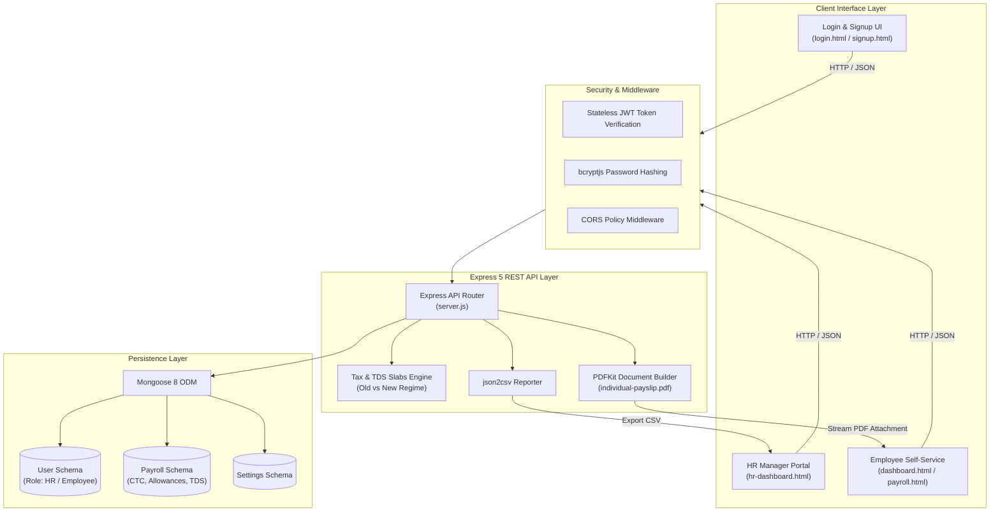

<div align="center">

<!-- Animated Header Wave Banner -->


<!-- Animated Typing Subtitle -->


<br>

<p align="center">
  
  
  
  
  
  
</p>

<!-- Live Operational Indicators -->
<p align="center">
  
  
  
  
</p>

<p align="center">
  <b>A comprehensive FinTech payroll and tax management platform built to automate Tax Deducted at Source (TDS), salary disbursements, statutory exemptions (80C, EPF, HRA), and dynamic PDF payslip rendering.</b>
</p>

</div>

---

### ⚡ Live Payroll & TDS Calculation Simulation

<div align="center">

<!-- Animated Interactive Payroll Terminal -->


</div>

---

## 📑 Table of Contents

- [Overview](#-overview)
- [System Architecture](#-system-architecture)
- [Core Features](#-core-features)
- [Tax Engine & Statutory Compliance](#-tax-engine--statutory-compliance)
- [REST API Specifications](#-rest-api-specifications)
- [Project Structure](#-project-structure)
- [Getting Started](#-getting-started)
- [Author & Connect](#-author--connect)

---

## 💡 Overview

Corporate HR departments and payroll specialists spend days calculating monthly **Tax Deducted at Source (TDS)**, evaluating employee exemption submissions, determining tax brackets under conflicting regimes, and distributing monthly payslips.

**Employee TDS Management System** automates this lifecycle:
- **Dual Tax Regime Computation:** Seamlessly calculates tax liabilities comparing the **Old Tax Regime** (with 80C, HRA, and Home Loan exemptions) against the **New Tax Regime** (with standard deductions and revised slab rates).
- **Statutory Breakdown:** Automates salary component allocation (Basic, HRA, DA, Medical, EPF, Professional Tax, and 4% Health & Education Cess).
- **Dynamic PDF Payslip Generation:** Compiles and streams branded, audit-compliant PDF salary slips using **PDFKit**.
- **Role-Based Access Control (RBAC):** Distinct dashboards for HR Managers (payroll generation, employee records, bulk analytics) and Employees (payslip history, tax statements).
- **Audit & Analytics:** Real-time system diagnostics endpoint (`/api/system/health`) and CSV data export capabilities using **json2csv**.

---

## 🏛 System Architecture

The application is structured into a modular MVC-style architecture backed by Express 5 and MongoDB:



---

## ✨ Core Features

| Feature | Details |
| :--- | :--- |
| 🧮 **Automated TDS Calculation** | Computes monthly and annual income tax liabilities with automatic slab adjustment and 4% tax cess. |
| 🔄 **Old vs New Tax Regimes** | Full support for Section 80C deductions, HRA exemptions, and home loan rebates in Old Regime, plus revised New Regime slabs. |
| 📄 **Dynamic PDF Payslips** | Built-in **PDFKit** rendering engine compiling complete breakdown tables (earnings, deductions, net salary) for instant download. |
| 👥 **Multi-Role Portals** | **HR Dashboard:** Add employees, process monthly payroll, view company tax totals. <br>**Employee Portal:** View salary history and download payslips. |
| 🔐 **Stateless JWT Security** | Secure password storage with **bcryptjs** (salt rounds: 10) and stateless token validation. |
| 📊 **Bulk CSV Reporting** | Streamlines accounting handoffs by exporting monthly payroll ledgers into formatted CSV spreadsheets. |
| 🩺 **System Diagnostics** | Built-in `/api/system/health` reporting live database connection status, memory utilization, and uptime. |

---

## 📊 Tax Engine & Statutory Compliance

The payroll model accounts for complex statutory salary breakdowns:

### 1. Earnings Breakdown
- **Basic Salary:** Base compensation foundation.
- **House Rent Allowance (HRA):** Subject to tax exemption under Sec 10(13A).
- **Dearness Allowance (DA), Medical & Special Allowances:** Fully taxable components.

### 2. Statutory Deductions
- **Employee Provident Fund (EPF):** Deducted and logged for 80C compliance.
- **Professional Tax (PT):** State-mandated deduction.
- **Section 80C Investments:** Life insurance, ELSS, PPF (capped at ₹1,50,000 in Old Regime).
- **Home Loan Interest:** Deductible up to ₹2,00,000 under Section 24(b).
- **Health & Education Cess:** 4% surcharge applied to computed income tax.

---

## 📡 REST API Specifications

### 🔐 Authentication
- `POST /api/auth/signup` – Register employee or HR account (password hashed with bcrypt)
- `POST /api/auth/login` – Authenticate credentials and return JWT bearer token

### 💰 Payroll & Tax
- `GET  /api/payroll/records` – Retrieve all payroll history for HR administrator
- `GET  /api/payroll/my-records` – Retrieve personal salary history for logged-in employee
- `POST /api/payroll/calculate` – Execute live TDS calculation comparing Old vs New tax regimes
- `POST /api/payroll/disburse` – Finalize and record monthly payroll entry

### 📄 Reports & Downloads
- `GET /api/reports/individual-payslip/:id` – Stream auto-generated PDF payslip via PDFKit
- `GET /api/reports/export-csv` – Export corporate payroll records into CSV via json2csv

### 🩺 System Diagnostics
- `GET /api/system/health` – Returns MongoDB connection state, uptime, and memory usage

---

## 📂 Project Structure

```
Employee-TDS-Management-System/
├── tds-backend/
│   ├── server.js              # Express 5 main application & route handlers
│   ├── models/
│   │   ├── User.js            # User authentication schema (Employee/HR roles)
│   │   ├── Payroll.js         # Comprehensive salary & tax deduction schema
│   │   └── Settings.js        # Global company & tax rate configuration
│   ├── public/                # Frontend client application
│   │   ├── index.html         # Portal landing page
│   │   ├── login.html         # Authentication interface
│   │   ├── signup.html        # Registration portal
│   │   ├── hr-dashboard.html  # HR manager payroll administration view
│   │   ├── dashboard.html     # Employee self-service overview
│   │   ├── payroll.html       # Salary ledger and calculation tools
│   │   ├── style.css          # Responsive dashboard styling
│   │   └── script.js          # Client-side API integration & event handling
│   ├── package.json           # Node.js dependencies (Express 5, Mongoose 8, PDFKit)
│   └── .env.example           # Environment template
└── README.md                  # Project documentation
```

---

## 🚀 Getting Started

### Prerequisites
- **Node.js** `18.x` or higher
- **MongoDB** (Local instance or MongoDB Atlas URI)

### 1. Clone & Set Up

```bash
# Clone repository
git clone https://github.com/anish03-hub/Employee-TDS-Management-System-Tax-Calculation-Employee-Record-Management.git
cd Employee-TDS-Management-System-Tax-Calculation-Employee-Record-Management/tds-backend

# Install dependencies
npm install
```

### 2. Configure Environment

Copy `.env.example` to `.env`:
```ini
PORT=5000
MONGO_URI=mongodb://localhost:27017/tds_management
JWT_SECRET=your_super_secret_jwt_key_here
```

### 3. Launch Server

```bash
# Start backend server
node server.js
```
The server will boot on **`http://localhost:5000`**. Open your browser to access the application.

---

<div align="center">

## 👨‍💻 Author & Connect

**Anish Kumar Sah**  
*Java Developer | Spring Boot & REST APIs | B.Tech CSE @ Symbiosis Institute of Technology, Pune*

[](https://www.linkedin.com/in/anishsah)
[](mailto:sah42515@gmail.com)
[](https://github.com/anish03-hub)

<br>

<!-- Animated Waving Footer Banner -->


<sub>Built with ❤️ using Node.js, Express 5, and MongoDB. Streamlining enterprise payroll and tax compliance.</sub>

</div>
